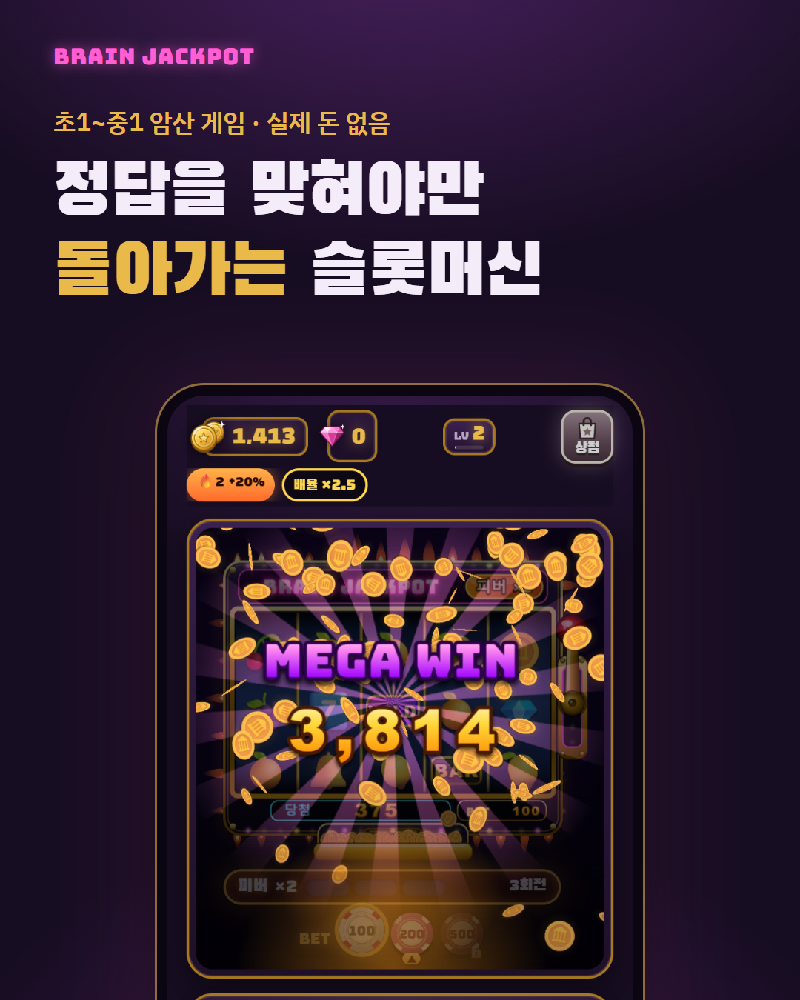
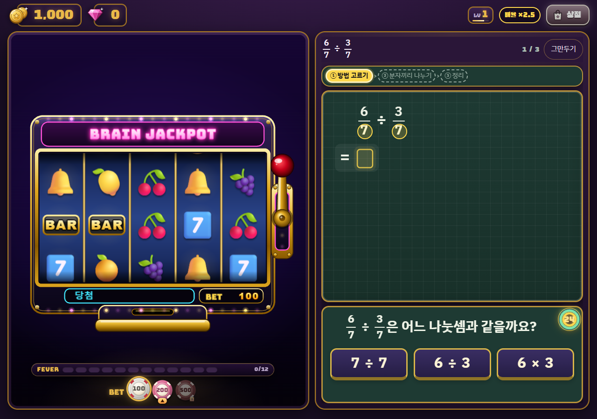
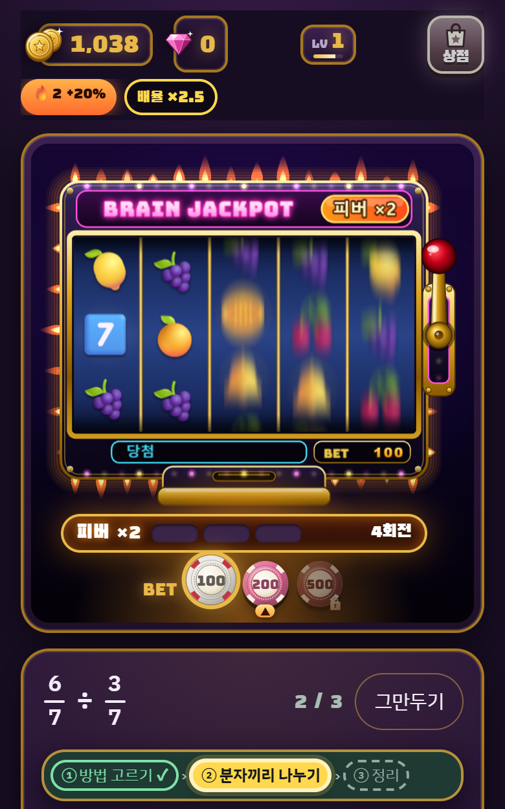
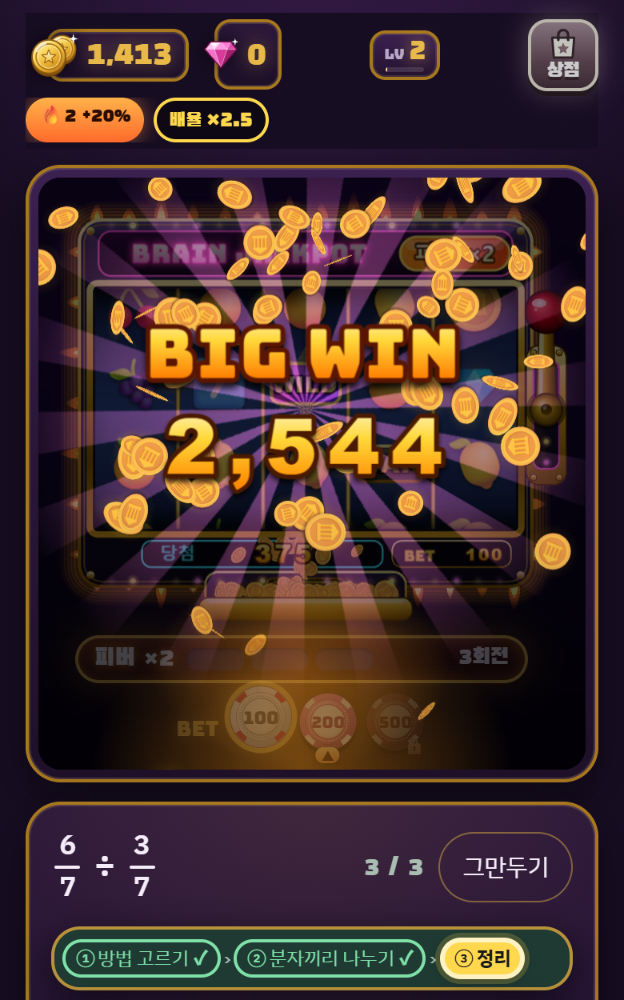
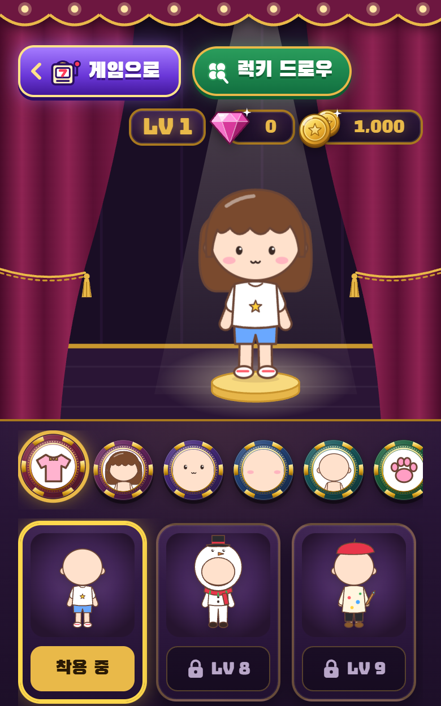
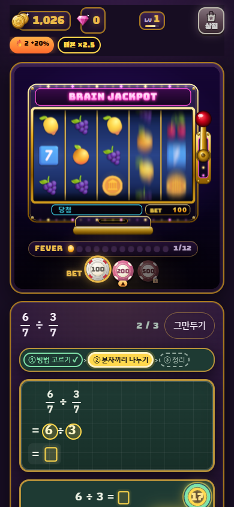

# 🎰 BRAIN JACKPOT 브레인 잭팟

**암산을 맞혀야만 레버가 당겨지는 5릴 슬롯머신.** 초등 1학년부터 중학교 1학년 수학까지.
실제 돈은 없습니다. 결제도 광고도 없는 무료 브라우저 게임입니다.

*A 5-reel slot machine that spins only when you solve a mental-math step — Korean elementary to middle-school math (grades 1–7). A free browser game with no real money.*

### ▶ [지금 플레이하기](https://theoceank.github.io/brain-jackpot/)

PC · 태블릿 · 휴대폰 브라우저에서 바로 됩니다. 설치나 로그인은 필요 없습니다.

---

## 어떻게 하나

1. **문제 카드를 고릅니다.** 카드마다 난이도(★1 초1~2 ~ ★5 중1)와 배율(×1 ~ ×3)이 붙어 있고, 어려운 카드일수록 배율이 큰 편입니다.
2. **한 단계씩 풉니다.** 큰 문제를 칠판 위의 작은 암산으로 나누고, 단계마다 세 답 중 하나를 고릅니다. 종이는 필요 없습니다.
3. **맞히면 슬롯이 돕니다.** 한 단계를 맞힐 때마다 레버를 한 번 당깁니다. 틀리면 돌지 않고, 돈으로도 돌릴 수 없습니다.
4. **빨리, 이어서 맞힐수록 커집니다.** 빨리 맞히면 ⚡ 골든, 이어서 맞히면 🔥 연속 보너스, 게이지가 차면 피버가 시작됩니다.
5. **번 금화로 레벨을 올립니다.** 레벨이 오르면 BET 칩이 커지고, 금화와 보석으로 드레스룸에서 옷과 펫을 삽니다.

| 피버가 켜진 기계 | 큰 당첨 연출 | VIP 드레스룸 |
|---|---|---|
|  |  |  |

### 들어 있는 것

- **5릴 비디오 슬롯**: 당첨 줄, BIG · MEGA · EPIC WIN 연출
- **홀드앤스핀 보너스**: 다시 돌리는 것도 문제를 풀어야 합니다
- **피버 게이지 · 피버 러시**: 게이지가 차면 피버가 되고, 운이 닿으면 기계가 통째로 바뀌는 피버 러시가 열립니다
- **레벨과 BET 칩**: 100에서 시작해 1천만, 그 위까지 올라갑니다
- **돋보기**: 같은 종류에서 두 번 막히면 다음에는 그 자리를 비춰 주고 시간을 더 줍니다
- **VIP 드레스룸**: 옷, 머리, 얼굴, 펫 꾸미기와 럭키 드로우
- **그림 · 소리 파일 0개**: 그림은 SVG와 Pixi.js로, 효과음과 배경음악은 Web Audio로 모두 코드 안에서 만듭니다

---

## 만든 원칙

- **풀이로만 돕니다.** BET을 걸어도 문제를 맞혀야 레버가 당겨지고, 돈으로는 돌릴 수 없습니다. 정답으로 연 피버 러시 8회전만 저절로 돕니다.
- **돈 단위를 쓰지 않습니다.** 금화와 보석만 씁니다. "원"을 붙이면 실제 돈처럼 읽히기 때문입니다.
- **쉬움 모드 대신 골든 타임을 둡니다.** 제한 시간은 넉넉히 두고(골든 타임의 3배), 빨리 맞히면 보너스를 줍니다. 맞힌 답은 깎지 않습니다.
- **파산해도 끝이 아닙니다.** 1,000으로 다시 시작하고, 산 옷과 보석은 그대로 남습니다.

---

## 개발 과정

2026-09-25부터 10-17까지 23일 동안 **커밋 449개, 게시 63판**을 거쳤습니다.

| 날짜 | 무엇이 생겼나 |
|---|---|
| 09-25 | 설계 문서 → 첫 플레이 가능본(분수 · 소수 나눗셈 한 단원만 있는 5릴 슬롯), 하루 만에 |
| 09-26 | **v2 "BRAIN JACKPOT"**: BET, ★1~★5 난이도(초1~중1), 배율 카드, 연속 정답 빅윈 상승, 문항 타이머, 파산, 상점, 금화 · 다이아몬드 그림 |
| 09-27 ~ 28 | 레벨과 경제를 모의 실험으로 다시 짬 → 정답마다 금화를 받는 새 경제 |
| 09-30 | 피버 게이지 |
| 10-01 ~ 03 | 화면 · 소리 판정 다듬기, BET 칩 소리와 무늬, 피버 러시를 시험대에서 고르기 |
| 10-04 ~ 05 | 피버 러시, 홀드앤스핀 정산 "팡 · 팡 · 파팡!!", 문항 기록 |
| 10-06 ~ 07 | 돋보기(막힌 곳 도움) |
| 10-12 ~ 13 | 레벨 업 보상 묶음: VIP 카드, 내 기록 |
| 10-17 | **v63**: 기존 문제 18가지 다듬기 |

### 만든 방식

사람 한 명과 AI 코딩 도구 [Claude Code](https://claude.com/claude-code)가 함께 만들었습니다.

- **사람**: 방향, 원칙, 모든 결정을 정합니다. 태블릿으로 직접 해 보며 손맛(소리, 속도, 난이도)을 판정합니다.
- **AI**: 설계 문서, 구현, 시험, 확인을 맡습니다. 여러 작업 세션이 나눠서 진행했습니다.

결정을 돕는 장치:

- **시험대 페이지**: 바꿀 안 두세 개를 실제 게임 화면에 나란히 띄워 놓고 보고 고릅니다(피버, 레벨 업, BET 칩, 돋보기 등).
- **모의 실험**: 정답률 70 · 85 · 95%의 가상 플레이어로 레벨 속도와 경제를 미리 잽니다.
- **교차 검토**: 큰 변경마다 다른 AI 모델이 내용과 동작을 따로 검토합니다.
- **헤드리스 브라우저 확인**: 실제 화면 좌표를 눌러 끝까지 플레이합니다. 움직임 줄이기 켬과 끔, PC 폭과 휴대폰 폭에서 모두 봅니다.
- **자동 시험 723개**

---

## 기술

- 바닐라 JavaScript(ES 모듈, 프레임워크 없음), 원본 코드 약 3만 2천 줄
- [Pixi.js](https://pixijs.com/) 8: 릴 그리기(WebGL)
- Web Audio: 효과음과 배경음악 합성
- SVG: 금화, 보석, 옷, 캐릭터
- localStorage: 진행 저장(이 브라우저에만)
- 개발은 빌드 없이 하고, 이 공개판만 [esbuild](https://esbuild.github.io/)로 압축했습니다

## 이 저장소에 대해

- **플레이용 압축본만 있습니다.** 원본 코드, 시험, 설계 기록은 공개하지 않습니다.
- **실제 돈은 없습니다.** 결제, 광고, 현금 교환이 없고, 금화와 보석은 게임 안에서만 씁니다.
- 진행은 플레이한 브라우저에 저장되며 다른 기기로 옮겨지지 않습니다.

© 2026 theOceanK. All rights reserved. 이 저장소의 코드, 그림, 소리를 복제 · 수정 · 배포하는 것을 허락하지 않습니다.
